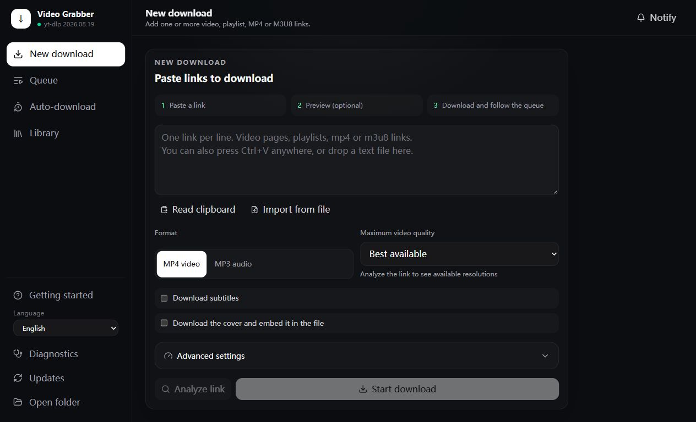

# Video Grabber

A private, local-first video, audio and image downloader powered by yt-dlp, with a desktop-style UI.

Paste a link, choose MP4, MP3, Keep source audio, Video cover or Direct image, and keep the result on your own computer. Video Grabber does not
require an account or a hosted service, and it does not send your links or cookies to a
project-owned cloud service. It connects directly to the sites you ask it to download from and to
PyPI when checking for yt-dlp updates.



Start with **New download**, optionally analyze the link, then follow progress in **Queue**.
Completed files appear in **Library**. See the [user guide](docs/USER_GUIDE.md) for previews,
batch controls, and reversible file management.

## Highlights

- Download individual videos, playlists and channels supported by yt-dlp.
- Choose MP4 quality limits or MP3 bitrate.
- Choose MP3 Highest quality (320 kbps), Standard quality (192 kbps), Save space (128 kbps), or a custom bitrate.
- Keep the best available source audio without re-encoding; its file format depends on the source.
- Download subtitles and cover art.
- Save only a video's cover, or download a direct JPG, PNG, WebP, GIF or AVIF URL in its original format.
- Filter images in Library and preview them at a fitted or original size; manage them with rename and recovery.
- Preview titles, thumbnails, duration and available resolutions before downloading; select playlist entries.
- Queue several downloads with live progress, batch cancellation/retry/removal, persistent pause/order,
  automatic restart recovery, and duplicate prevention for active links with the same settings.
- Retry recorded failed playlist entries without re-downloading successful entries.
- Search and filter Library by source and format; paginate all discovered files and review scan limits.
  Rename files or move them to recoverable local storage together with matching subtitles and covers.
- Select Library files in batches; restore or permanently delete Recovery selections with confirmation.
- Favorite files and organize them in multiple virtual collections, with individual and batch controls.
- Repair unfinished downloads locally using saved settings, with original inputs kept until success.
- Review the success rate plus categorized failures with an actionable suggested fix.
- Subscribe to a channel or playlist and filter new entries by title, live/Shorts status, or duration.
- Switch the core interface between English, Simplified Chinese, Traditional Chinese, and Japanese.
- Use the first-run guide to automatically check readiness and prepare missing download features.
- Fall back to static page scanning or optional browser rendering for less common sites.
- Use a dedicated public-download-page fallback for `hanime1.me`; use yt-dlp's native Iwara extractor
  with browser impersonation support.
- Diagnose ffmpeg, yt-dlp, Deno, Playwright, cookies and network problems from the UI.
- Run in a native pywebview window, a normal browser tab, or directly from the CLI.

Only download content you have the right to download. The application does not bypass DRM or
access controls.

## Quick start

```
python -m venv .venv
# Windows: .venv\Scripts\activate
# macOS/Linux: source .venv/bin/activate
python -m pip install -e ".[desktop]"
python webui.py
```

Python 3.10 or newer is required. The base install includes yt-dlp, its default components, Deno,
and `curl_cffi` for sites such as Iwara that require browser impersonation. The `desktop` extra adds
pywebview for a native app window; without it, the app falls back to your default browser. ffmpeg is
still a system dependency for video/audio processing and must be available on PATH for those modes.
Cover-only and direct-image downloads do not require ffmpeg.
Keep source audio uses ffmpeg for extraction and metadata, but never silently converts an unsupported
codec to MP3. Covers in this mode are saved separately. A higher MP3 bitrate cannot restore details
already lost in the site's audio; source audio is not necessarily the creator's original recording.

Diagnostics verifies that ffmpeg and its companion ffprobe can actually start, and displays their
resolved paths. To select a specific installation, use `python webui.py --ffmpeg-location "PATH"`
or `python grab.py URL --ffmpeg-location "PATH"`, where `PATH` is the executable or its directory.
`GRAB_FFMPEG_LOCATION` provides the same setting through the environment. yt-dlp receives this
absolute location explicitly. If Windows application control blocks it, Diagnostics reports the
launch error; selecting a path does not override Windows security policy.
MP4/MP3 queue tasks check ffmpeg before requesting media from the source. If it cannot start,
the task fails immediately with details in its log. Cover-only and direct-image tasks skip this check.

Page rendering for sites that load media dynamically is optional:

```
python -m pip install -e ".[render]"
```

By default this opens in its own window (`--ui window`). If `pywebview` is not installed, it
automatically opens your default browser instead and tells you so. Use `--ui browser` to always
use a browser tab, or `--ui none` when developing the frontend with `npm run dev`.

Run `python webui.py --help` for all options (download folder, port, worker count,
`--sub-interval` for how often subscriptions are re-checked).

**Subscriptions**: add a channel or playlist link in the "Subscriptions" panel to have new videos
download automatically (checked every 60 minutes by default). New subscriptions only grab videos
published from then on unless you choose to also back-fill a recent batch when adding one. Filters
are stored per subscription. Duration filters apply only when the site exposes duration metadata;
items filtered out are marked as seen so they are not repeatedly reconsidered on every check. Each
subscription shows the result of its last check. **Preview filters** reads the current listing
without queuing downloads or changing the seen history; entries outside the current backfill or
already seen entries are labeled as such. The preview counts all current candidates, including
matches and filtered entries, even when the displayed list is shortened.

The first-run guide opens automatically for a new, empty installation and can be reopened from
the sidebar. **Prepare download features** installs missing supported components on Windows and
restarts the service when needed. No command or executable path is required. Windows application
control blocks are explained separately and cannot be removed by this button.
The language selector is also in the sidebar (or the mobile header). Technical extractor logs and
some site-supplied diagnostics remain in their original language.

Queue failures provide plain explanations and relevant actions, including preparation, retry,
opening the source page or folder, and repairing unfinished media. Browser sign-in retries require
an explicit browser selection and confirmation. Technical errors remain in the collapsed log.
Completed downloads offer **Play video**, **Play audio**, or **View image**, plus **Show in folder**.
New download shows an output summary and the current save folder. **Change folder** opens the
system chooser, remembers the selection and restarts the app after pending downloads finish or
are canceled. Existing files stay in place; each folder retains its own Library, Queue history,
Recovery records and Auto-download settings. An explicit `--dir` overrides the remembered folder.
Moving files to Recovery offers **Undo**, including bulk moves. Temporary network failures retry
the failed entry at most twice and show **Reconnecting**; canceled jobs stop waiting immediately.
**Diagnostics** remains available for advanced checks and optional components.

Application data stays local:

- Downloads, task history and subscriptions live under the selected download directory.
- Uploaded cookies are stored in the operating system's user configuration directory, not beside
  downloaded media and never exposed through `/files`.

## Windows Portable ZIP

The portable release is for 64-bit Windows and includes the official CPython embeddable runtime.
It does not need a separately installed Python, administrator access, registry changes, or files in
Program Files.

1. Extract the complete ZIP to a writable folder.
2. Double-click `Start Video Grabber.cmd`.
3. The application opens in a native Windows WebView2 window. If WebView2 is unavailable it falls
   back to the default browser; `Start Video Grabber.cmd --ui browser` always uses a browser tab.
4. On first run, the bootstrap downloads ffmpeg, Deno, yt-dlp components and the pywebview desktop
   shell. Native release assets
   must have a GitHub-provided SHA-256 digest and are installed only after it matches.
5. `Install Playwright.cmd` adds optional page rendering. It uses an installed Edge or Chrome when
   available, so downloading a separate browser is normally unnecessary.
6. `Update Components.cmd` checks the trusted sources for newer components.

Downloads and settings stay inside the extracted folder. Exact native component sources, versions
and hashes are recorded in `runtime/components.json`. See `THIRD_PARTY_NOTICES.md` for component
licenses.

The project is currently unsigned. Windows SmartScreen can therefore show an **Unknown publisher**
warning for a ZIP downloaded from the internet. Verify the published `.sha256` file before opening
it. A checksum verifies the downloaded bytes but does not replace code signing.

To build the ZIP from a Windows development checkout:

```powershell
powershell -ExecutionPolicy Bypass -File scripts\build_portable.ps1
```

The ZIP and its SHA-256 file are written under `artifacts/`. The build pins the official Python
embeddable archive and verifies its checksum; ffmpeg, Deno, yt-dlp and optional Playwright remain
first-run downloads.

## Updating source archives

Unzip the release **over** your project folder and let it replace files. Then delete any older
`index-*.js` / `index-*.css` files inside `webui_dist/assets/` - each build has new file names, and
the old ones are just dead weight. The folder must end up like this (the `assets/` subfolder matters):

```
webui_dist/
  index.html
  assets/
    index-XXXXXXXX.js
    index-XXXXXXXX.css
```

If it is wrong, `python webui.py` prints a `WARNING` at startup naming the missing file, and
Diagnostics shows "Interface files" as a warning, instead of quietly showing the old page.

## CLI image downloads

```sh
python grab.py "VIDEO_URL" --mode cover
python grab.py "https://example.com/photo.png" --mode image
```

Cover-only downloads use yt-dlp's site extractors and save under `covers/`. Direct-image downloads
save under `images/` and accept URLs with or without an image extension; the response must contain
a supported image. Both keep the original format and enforce a 100 MiB limit per image. Proxy,
cookies, Referer and rate-limit settings apply. Images are downloaded as manual queue tasks;
automatic subscriptions support MP4, MP3 and source audio.

## Audio and Library organization

Use **Keep source audio** for the best available site audio without re-encoding. For example,
AAC in a video can be extracted to M4A by copying the audio stream. Some older players may not
support the resulting format. The CLI equivalent is `python grab.py "URL" --mode original`.

Library's star buttons and **Favorites** filter provide quick access. **Manage collections** creates,
renames and deletes virtual collections. Select files and choose **Organize selected collections**,
or use a file's collection button, to add or remove membership. Classification does not copy or move
files. Deleting a collection keeps its files and favorites. Classification stays with files renamed
in the app and moved to/restored from Recovery, and is retained across restarts. As with other
Library metadata, it is local to the selected download folder.

## Tests

```
python -m pip install -e ".[dev]"
python -m ruff check .
python -m pytest -q
```

These need ffmpeg on PATH for the download tests; everything else runs without it.

See [CONTRIBUTING.md](CONTRIBUTING.md) for the complete backend/frontend workflow and privacy-safe
bug reporting guidance.

## Development layout

```
grab.py          Command-line downloader. See `python grab.py --help` / `python grab.py --doctor`.
webui.py         Local web server: the API, services, and the app window/browser tab.
grab_config.py   Validated Web UI startup configuration and CLI parsing.
grab_download.py Structured yt-dlp item failure tracking for selective retries.
grab_images.py   Bounded, atomic downloads of original-format images and video covers.
grab_library.py  Local media metadata and reversible management of media and companion files.
grab_models.py   Job and subscription state, views, and persistence schemas.
grab_sites.py    Small isolated adapters for sites that need a stable non-generic fallback.
grab_state.py    Thread-safe job and subscription registries.
grab_storage.py  Atomic JSON persistence used by job history and subscriptions.
portable_*.py    Secure first-run bootstrap and Windows Portable launcher.
scripts/         Reproducible release/build scripts.
webui_dist/      The built React interface (prebuilt - you do not need Node.js to run this).
frontend/        Source for that interface (React + TypeScript + Tailwind). See frontend/README.md.
tests/           Backend tests (pytest).
```
