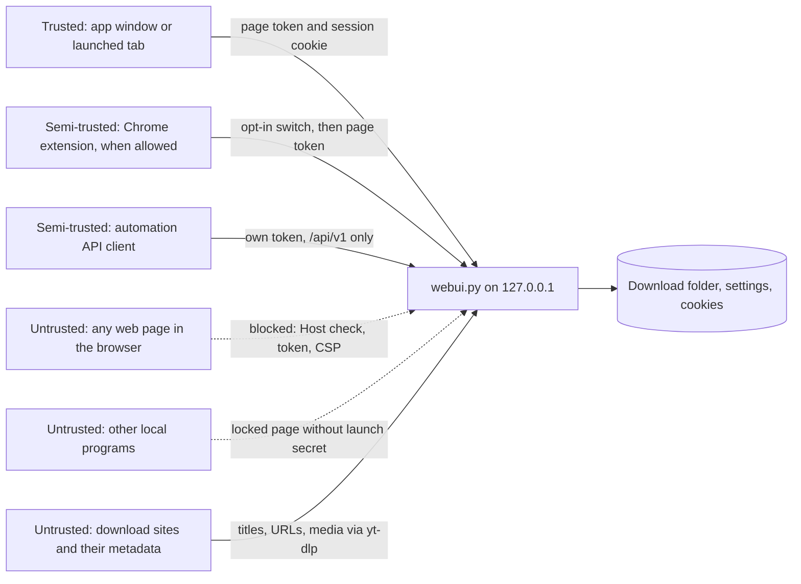

# Security model

Video Grabber runs a small HTTP server on the user's own computer and drives yt-dlp and ffmpeg.
A local web server is a common source of real vulnerabilities: any web page the user visits can
send requests to `127.0.0.1`. This document describes what the app protects, from whom, and how.
It covers what exists in the code today. Planned remote access is out of scope until it is built.

## Assets

| Asset | Where it lives | Why it matters |
| --- | --- | --- |
| Uploaded `cookies.txt` | Outside the download folder; path shown in Diagnostics (`grab_cookies.py`) | Grants access to the user's site accounts |
| Media files and companions | Download folder (`ROOT`) | User data; deletion must be recoverable |
| Library metadata (tags, notes, collections, Recovery records) | `.grab-library.db` plus a JSON mirror in the download folder (`grab_storage.py`) | Hours of manual organisation |
| Hook commands | A settings file the user edits by hand (`grab_hooks.py`) | Runs arbitrary programs |
| Notification targets (Discord, Telegram, ntfy, webhook URLs) | The same hand-edited settings file as hooks (`grab_push.py`) | Their URLs and tokens are secrets |
| Automation API token | Only its SHA-256 hash is stored (`grab_api.py`) | Lets another program queue downloads |

## Trust boundaries

## Threats and mitigations

| # | Threat | Mitigation | Code |
| --- | --- | --- | --- |
| T1 | **Cross-site request forgery**: a web page posts to `http://127.0.0.1:<port>/api/...` | Every API request needs the per-run `TOKEN` in the `X-Token` header. A custom header cannot be sent cross-origin without a CORS preflight, and the server has no `OPTIONS` handler and sends no CORS headers. POST routes also require `application/json`. | `Handler._authed`, `do_POST` |
| T2 | **DNS rebinding**: an attacker's domain re-resolves to `127.0.0.1` so the browser treats it as same-origin | The `Host` header must be `127.0.0.1` or `localhost` (`HOST_RE`); any other host gets 403 before routing. | `Handler._guard` |
| T3 | **Token theft by another local program or page** reading the start page | The page that embeds the token is served only to a client holding the launch secret (`?n=` in the link the app opens itself) or the `HttpOnly; SameSite=Strict` session cookie that link sets. Everyone else gets a static "locked" page. The extension gets it only while the user's opt-in switch is on. | `Handler._root_access`, `_handle_root_page` |
| T4 | **Token leakage through URLs and referrers** | The token travels in a header. Media elements, which cannot send headers, use the session cookie for `/files/` instead. Pages send `Referrer-Policy: no-referrer`. A URL token is accepted only for legacy `GET`. | `do_GET`, `_handle_root_page` |
| T5 | **Script injection from site metadata** (a video title containing HTML) | The React UI renders text, not HTML. The page ships a strict CSP: `script-src 'self'`, `connect-src 'self'`, `frame-ancestors 'none'`. Responses set `X-Content-Type-Options: nosniff`. | `_handle_root_page`, `_send` |
| T6 | **Path traversal** through `/files/<path>` or rename/move requests | Paths are resolved and must stay under `ROOT`; dot-folders (Recovery, metadata) are never served; only known media suffixes are served. Library moves re-check file identity before acting. | `Handler._file`, `grab_library.py` |
| T7 | **Command injection through hooks** | Hook commands and notification channels come only from a hand-edited settings file. No HTTP route can change them, because the extension shares the page token once allowed; notification URLs are never returned to callers, only their type and host. Commands run without a shell, with a bounded number of arguments and a timeout; titles and URLs reach the program through stdin JSON and `VG_*` variables, never the command line. | `grab_hooks.py` |
| T8 | **Automation API misuse** | Off by default. Its token is separate from the page token, shown once and stored only as a SHA-256 hash; the page token never authorises `/api/v1`, and the API token authorises nothing else. | `grab_api.py`, `webui_routes_api.py` |
| T9 | **Cookie exposure** | `cookies.txt` is validated, stored outside the download folder, never served back to the browser, and copied per run for yt-dlp. | `grab_cookies.py` |
| T10 | **Resource exhaustion with large bodies** | JSON bodies are capped at 1 MB (`BODY_MAX_BYTES`). Rejected bodies are drained only up to that limit and for at most one second, then the connection closes. | `_body`, `_discard_rejected_body` |
| T11 | **Irreversible data loss from a bug or a mistaken click** | Deletes move files to Recovery with companions; Undo restores them. Duplicate cleanup always keeps one copy and needs explicit review. Media export never overwrites or deletes. Backups use a field allowlist and exclude credentials, URLs and subscriptions. | `grab_library.py`, `grab_organizer.py`, `grab_mediaexport.py`, `grab_backup.py` |
| T12 | **Tampered dependencies in the portable build** | Downloaded build dependencies are pinned by version and verified by SHA-256; releases publish a checksum. | `scripts/build_portable.ps1`, `.github/workflows/release.yml` |
| T13 | **Leaking private data in diagnostics** | Diagnostics and logs report types and host names, not channel URLs or tokens. | `webui.py` (diagnostics) |

## Known limits and residual risk

- **Same-user local programs are not an adversary we can stop.** A program running as the same
  Windows user can read the settings and cookies files directly. The locked start page raises the
  bar against casual misuse; it is not a sandbox.
- **The Chrome extension, once allowed, holds the page token.** That is why hook commands are not
  configurable over HTTP. Any future route that can run programs or change security settings must
  keep that property.
- **Plain HTTP on loopback.** Traffic never leaves the machine, so TLS adds no protection here.
  This assumption breaks the moment the server listens on another interface; remote access needs
  its own design (separate listener, per-device tokens, narrower routes, HTTPS).
- **yt-dlp and ffmpeg parse untrusted media and web pages.** Their vulnerabilities are inherited.
  The app reduces exposure by offering one-click yt-dlp updates and showing the resolved ffmpeg path.
- **Notification webhook URLs are secrets stored in plain settings**, protected only by file
  permissions.

## Reporting a vulnerability

Please open a private security advisory on GitHub rather than a public issue.
