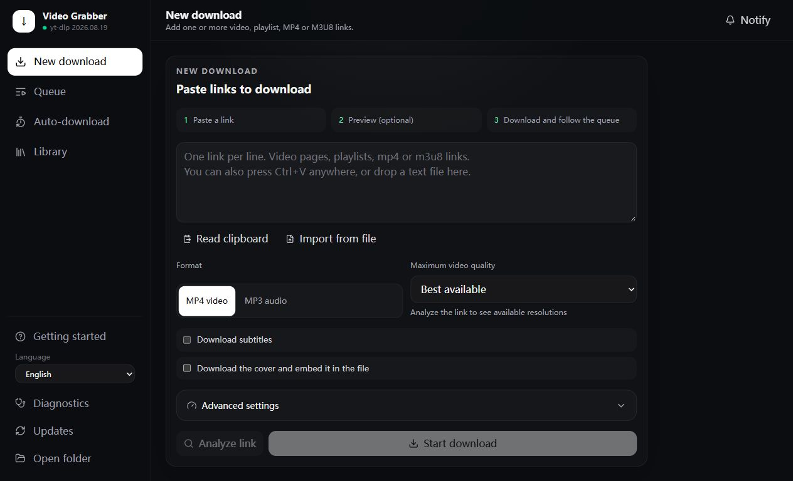
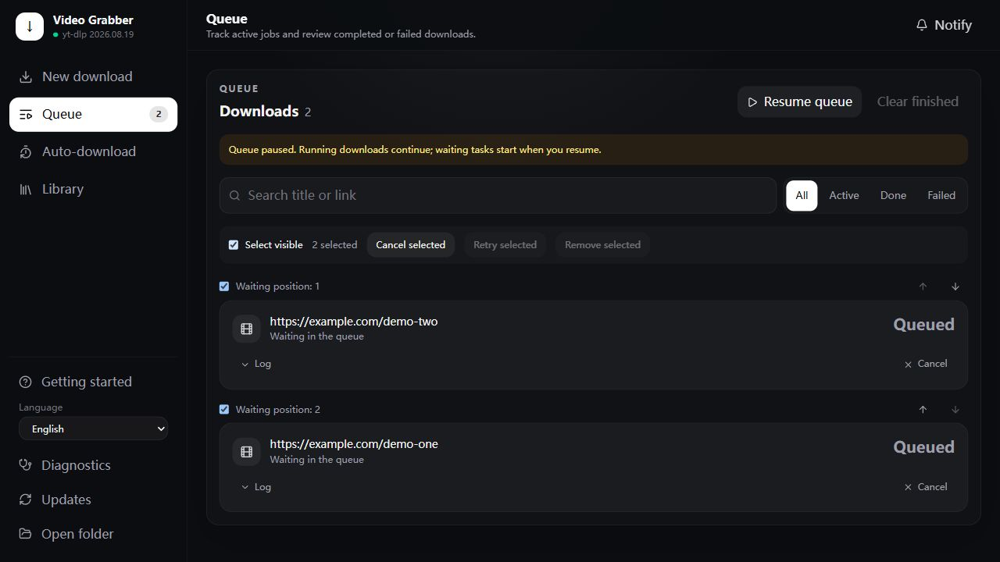
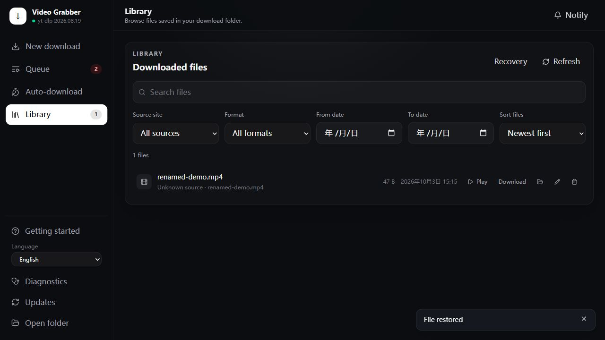

# Using Video Grabber

The application works locally in a desktop WebView or a browser. The sidebar separates
**New download**, **Queue**, **Auto-download**, and **Library**. Use **Getting started**
to reopen the introductory guide; **Diagnostics** checks components and connectivity.

The guide checks download readiness automatically. On supported Windows installations, click
**Prepare download features** to install missing components; the app restarts its service if needed.
If Windows blocks a component, open **Technical details** for the specific file. Preparation does
not change Windows security policy. You can still choose **Download images for now**.

Queue errors show a short explanation and actions such as preparation, opening a folder, repair,
or retry. For sites requiring sign-in, open the source page and sign in, then choose a browser and
confirm its use for retry. The app does not read a browser session before that confirmation.
Expand **Log** for technical details. Completed downloads offer **Play video**, **Play audio**,
or **View image**, alongside **Show in folder**.

## Your first download

1. Paste one or more links, one per line, in **New download**.
2. Choose MP4, MP3 or **Keep source audio**, or choose **Video cover** / **Direct image**.
   **Analyze link** is optional.
3. Click **Start download**. The app opens **Queue** automatically.

MP3 offers **Highest quality** (320 kbps), **Standard quality (recommended)** (192 kbps), and
**Save space** (128 kbps). Expand **Custom bitrate** for 96 or 256 kbps and the other exact values.
Existing saved bitrates are retained. Higher MP3 bitrates do not restore details missing from the source.

**Keep source audio** selects the best available site audio without re-encoding. The file format
depends on the source, such as M4A or Opus, and older players may not support it. This is the site's
offered audio, not necessarily the original recording. Covers are saved as separate JPG files in this
mode. It is also available for Auto-download subscriptions. Unsupported extraction fails with a
message rather than silently converting to MP3; you can choose MP3 for broader playback compatibility.

Before starting, **You will save** summarizes the format, quality, subtitles, covers and playlist
selection. It does not require link analysis. Without a preview, the summary explains whether a
playlist link would download every entry, a specified range, or just one video.

**Save to** shows the current folder. Click **Change folder** to choose an existing writable folder
using the system dialog. Finish or cancel queued downloads first. The app remembers your choice
and restarts automatically to apply it. Canceling the dialog changes nothing. Each folder has its
own Library, Queue history, Recovery and Auto-download settings; switching folders does not move
or delete anything. Switch back to manage the original folder again. An explicit `--dir` takes
priority over the saved selection.

Temporary connection resets, timeouts and temporary HTTP errors retry the affected item at most
twice. Queue shows **Reconnecting (1/2)** or **Reconnecting (2/2)** while waiting. Completed playlist
entries are kept. Cancel stops the retry wait immediately. Sign-in, permission, certificate and
Windows application-control errors require attention rather than repeated requests.

Analysis previews the first link only. Supported sites can provide a title, thumbnail,
duration and available video resolutions. The size estimate describes the selected format;
MP3 estimates use duration and output bitrate. Estimates are not final sizes: conversion,
container overhead and site metadata can change the result. Unknown sizes remain unknown.
After changing quality or format, analyze again to update the estimate.

For a single playlist link, the preview displays up to 100 entries using their original
playlist indices. Check entries to download only that selection. Selecting none disables
download. **Select preview entries** selects only the displayed entries, not the whole
playlist. To download other entries, use the advanced **Playlist range** setting instead.
Existing simple ranges are reflected in the preview; advanced slice syntax stays in the
range field without being approximated by the checkboxes. Preview-generated selections
apply to the current link and are cleared when it changes or is submitted.

Analysis does not download media, but it connects to the source site. It uses the configured
proxy, cookies and Referer. An analysis failure does not guarantee that download will fail.

## Download covers and images

Choose **Video cover** for a video page supported by yt-dlp. The app extracts its thumbnail URLs
and tries the best available supported image, without downloading the video or converting the
image. Files go under `covers/`; playlist covers retain their playlist numbering. Missing covers
are reported as failures, and recorded failed playlist entries can be retried from Queue.
This differs from the MP4/MP3 **Download cover** option, which saves cover art with its media file.

Choose **Direct image** for a URL that returns image bytes. A page containing pictures, a gallery
page or an HTML sign-in page is not a direct image URL. JPG/JPEG, PNG, WebP, GIF and AVIF are
supported, with a 100 MiB limit per image. The app checks the response type and image signature
and saves the original bytes under `images/`. URLs do not need a filename extension. Analysis
reads the image header to report its format and known size; it does not save a file.

Both modes use the configured proxy, cookies, Referer, download speed limit and request delay.
They do not require ffmpeg. Unsupported responses, expired links and authentication failures
produce failed tasks. Incomplete downloads stay hidden and are removed on cancellation or error;
retry starts the image download again. These modes support manual tasks only; Auto-download
subscriptions support MP4, MP3 and source audio.

## Manage the queue

MP4, MP3 and source audio tasks verify that ffmpeg can start before downloading media. A missing or blocked
executable fails the task immediately; expand its log and open Diagnostics to see the selected
path and launch error. The application does not change Windows application control policies.

- **Pause queue** prevents workers from starting waiting tasks; running downloads continue.
  Resume to start waiting tasks again. Pause and waiting order are saved across restarts.
- Move waiting tasks up or down. Running jobs cannot be reordered.
- Select individual tasks, or **Select visible** after filtering the list.
- **Cancel selected** requests cancellation of queued/running jobs.
- **Retry selected** creates new tasks with the original settings for failed/canceled jobs.
  For failures with recorded playlist indices, only those indices are retried, preserving
  playlist numbering and filenames. Failed individual links can also be retried separately.
  Expand **failed items** to see the recorded entries. If an error cannot be attributed to an
  entry (for example, the playlist itself cannot be loaded), Retry uses the original selection.
  Canceled jobs retry the original selection so unattempted entries are not lost.
- **Remove selected** removes finished task records, not downloaded files.

The result message reports processed and skipped tasks. A task that changed state, or is not
eligible for the chosen action, is skipped. Cancellation of a running download can take time;
partial files may remain. Worker concurrency means several tasks may start close together.

Waiting and interrupted running tasks return to the queue automatically when the application
restarts, with interrupted transfers placed before the saved waiting order. A paused queue
stays paused. Explicitly canceled tasks stay canceled. Existing partial video downloads are
continued when the source supports it; MP3 work uses a persistent hidden work directory across
restarts/retries. Recovery does not guarantee continuation through conversion or an expired URL.
Completed entries may be checked again when an interrupted playlist resumes; enable the download
archive to skip completed entries. Keep the download folder and history file together.

Submitting the same link with the same settings while it is queued or running skips that duplicate
and reports the skipped count. Different settings and finished tasks can still be submitted.
Duplicate retries are also skipped. This checks links/settings, not whether different URLs point
to the same underlying video.

## Manage your library

Click a file's star to favorite or unfavorite it. **Favorites** filters the list; search and the
other filters still apply. Select files to favorite or unfavorite them in batches.

Use **Manage collections** to create or rename collections such as Music, Study or Watch later.
Use a file's collection button, or **Organize selected collections**, to add or remove files. A file
can belong to multiple collections. The collection selector filters the list; **Reset filters**
returns to all files. These actions never move or copy the actual files.

Deleting a collection requires confirmation and removes only that classification. Files and favorites
remain. Favorites and membership survive app restarts, in-app file renames, and Recovery/Undo.
Each download folder has its own collections, as it does its own Library.

Files whose transfer finished but whose postprocessing did not finish are labeled
**Processing incomplete** in Queue and Library. This includes unmerged video/audio streams and
media whose requested conversion or cover embedding failed. The label persists across restarts
and follows rename/recovery. Existing fragment files from retained failed tasks are recognized
using their `.f400.mp4` / `.f140.m4a` naming pattern; imported files are not labeled solely from
their names. Files remain available for inspection and are not automatically deleted.

Search filenames, paths or titles; filter by media type, source site, file format. Sort by date,
name or size. Dates use the recorded download time, falling back to the file modification
time for older/imported files. Files without source metadata are labeled **Unknown source**.
The Library scan covers four directory levels and checks up to 20,000 entries. All discovered
media files are retained, with 25, 50 or 100 files per page after filtering/sorting. The footer
shows the visible range. Scanning reports checked entries and media counts; warnings explain
entry limits, depth limits and unreadable paths. Search and filters cover discovered files only
when a scan is incomplete. Hidden folders and symlink files are excluded. Click **Refresh** to
rescan files added or changed outside the app.

Choose **Images** in the media-type filter to see standalone images. Click an image thumbnail or
**Preview image** to open its preview, switch between fitted and original size, or download the
original file. Browser support determines whether a format can be displayed. Images retain
the same source-page, folder, rename and recovery actions as videos and audio.

Existing same-stem images beside video/audio files are treated as cover companions and stay
grouped with their media instead of appearing as separate Library cards. Images downloaded using
the new modes are explicitly recorded as standalone images, even if their names match a video.
Imported images with matching video names should be moved to a separate folder to make their
standalone role unambiguous.

**Rename** changes the filename only and preserves the extension. It refuses invalid Windows
filenames and existing destinations. Source metadata persists separately from task history,
so clearing completed tasks does not erase the source information for new downloads.
**Original page** opens the saved source URL when available.

**Move to recovery** requires confirmation and moves the media file into the hidden
`.grab-trash` directory inside the download folder. This is application-managed recovery,
not the Windows Recycle Bin. Files still occupy disk space and are not automatically purged.
After a single or batch move, click **Undo** in the notification to restore the successfully moved
files and their companions. Undo stays until used or dismissed. Failed restores remain available
for retry; existing files are never overwritten. Permanent deletion has no Undo.
Library displays long filenames with up to 24 title characters followed by an ellipsis and the
original extension. Hover to see the full name. Files on disk and download names remain unchanged.

Open **Recovery** to permanently delete an item and its matching subtitles/covers after confirmation,
or restore an item to its original location; if that location is occupied,
rename or move the conflicting file first. The app never overwrites it. Keep
`.grab-library.json` with the download folder so recovery records and source metadata remain
available. Same-stem cover files and same-stem subtitles (including language suffixes such as
`.en.srt`) are renamed, moved and restored with the media. A destination conflict or locked file
blocks the operation; completed moves are rolled back on failure. If multiple media files share
the same stem and companions, management is blocked to avoid taking another file's attachments;
give those files unique names and organize their companions in the file manager first.
Permanent deletion cannot be undone. If deletion fails partway through, the recovery record remains
so you can retry; already deleted companions cannot be restored.

File-changing actions are blocked while downloads are running. Pause the queue and wait for
running downloads to finish before editing files. A player holding a file open may also need
to be closed. Recovery contents are not served through the media playback endpoint.

## Batch management and local repair

Select individual files or **Select this page** in Library, then **Move selected to recovery**.
Selections carry across pages. The confirmation includes the selected main-file size; companions
move with each file. Recovery supports **Select all**, **Restore selected**, and **Delete selected
permanently**. Its size includes stored companions. Permanent deletion requires confirmation.
Partial failures leave unsuccessful items selected for retry and report the success/failure counts.

For a known unfinished download, **Repair** adds an offline task to Queue using the original saved
MP4/MP3, cover and subtitle settings. It checks local video/audio streams, works on temporary
copies, and verifies the output before replacing it. It does not contact the source site.
Successful merges/conversions move superseded inputs into Recovery. Cancellation or a processing
failure keeps originals intact. Missing/ambiguous inputs or missing requested covers/subtitles
require downloading the original item again. A completed output is never overwritten.

## Language and connectivity

English, Simplified Chinese, Traditional Chinese and Japanese are available in the sidebar.
Site-provided titles, logs and some diagnostic details retain their original language.
Use a valid HTTP/SOCKS proxy address only when you have a proxy service listening there;
the application's own UI port is not a proxy. Diagnostics never changes system DNS settings.

Download only content you have permission to download. Site rate limits, authentication,
network restrictions and DRM remain outside the application's guarantees.
